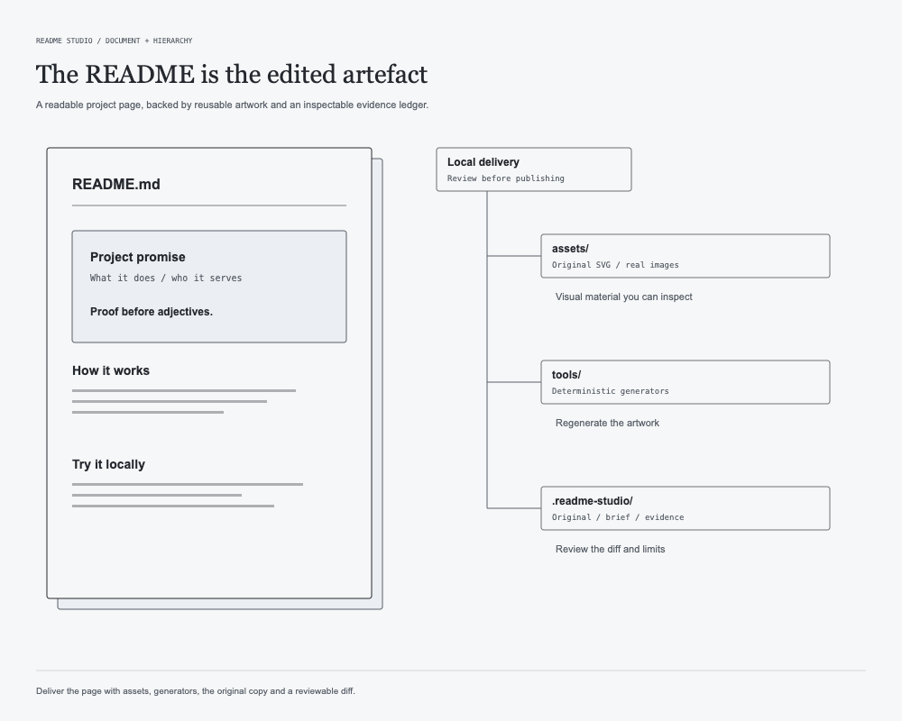

<h1 align="center">README Studio</h1>

<p align="center"><b>An Agent Skill that designs GitHub READMEs, for your profile or for any repository, the way a careful designer would:<br>by studying the real work, choosing what to say, building a visual system, and checking it actually renders.</b></p>

<p align="center"><sub>Open <a href="https://agentskills.io/specification">Agent Skills</a> format · tested in Codex CLI and OpenCode · discovered by Claude Code · MIT</sub></p>

## The output and the checks

The deliverable is a README backed by inspectable local material: its original copy, the editorial brief, generated assets and the change diff. The agent chooses what to say and how to organize it; scripts provide repeatable checks for the parts that can be measured.



图左为排版样本，图右为 Skill 实际描述的交付目录；没有伪造发布页面截图。

| Tool | Checks or produces | Limit |
| --- | --- | --- |
| [`check_readme.py`](skills/readme-studio/scripts/check_readme.py) | Paths, heading anchors, unsafe HTML, private-data patterns and SVG lint; optional real sanitizer checks | Static checks do not certify visual quality |
| [`render_preview.py`](skills/readme-studio/scripts/render_preview.py) | Light, dark and phone-width previews from rendered Markdown | Local styling and image handling differ from github.com |
| [`svg_kit.py`](skills/readme-studio/scripts/svg_kit.py) | SVG generation, text width estimates and asset lint | Viewer fonts can change text geometry |
| [`validate_skill.py`](tools/validate_skill.py) | Skill structure, reference paths and bundled script checks | Repository validity does not replace a full agent run |

The final handoff records what was actually checked and what still needs a human view. Publishing stays with the user; the tools do not turn a successful check into permission to push.

## The problem

Most READMEs come out of a template. Project READMEs get a badge row, a feature list of adjectives and an install block. Profiles get `Hi 👋 I'm …`, a wall of badges, a stats card, a contribution snake. Generators make that faster, but every output still looks like every other one, because the layout *is* the product.

A good README is the result of decisions:
- what is true and worth saying (for a project, what the code actually does);
- what leads: which one or two projects, or which proof of the project;
- what the page's visual system is, and why it belongs to this person or project;
- what GitHub (and npm or PyPI) will silently delete.

This skill gives an AI agent the method behind those decisions, so it can make them for *you*.

## How it differs from a template generator

| | Template generator | README Studio |
|---|---|---|
| Output | Fixed layout, your name filled in | A layout designed from your work, voice and taste |
| Content | Everything it can fetch | An evidence ledger. Leads, featured, archive and cut are chosen and justified. No invented skills or metrics. |
| Visuals | Stock badges, third-party stats cards | Original SVG written by a generator script in your repo, or your real screenshots, light and dark |
| GitHub limits | Hopes for the best | Built from a measured sanitizer table; checks against GitHub's own Markdown API |
| Existing README | Overwritten | Keep-list, diagnosis, a diff, original kept |
| Publishing | Often pushes for you | Never. Local files plus instructions; you publish |

Defaults it deliberately avoids unless you ask: stats cards, streaks, trophies, snakes, typing banners, visitor counters, badge walls.

## What the agent does

```
Discover ──► Architect ──► Art direction ──► Build ──► Verify ──► Hand over
evidence     reading order   concept from     README +   real sanitizer,  checks table,
ledger,      lead/featured/  your material,   generator  links, SVG lint, "not verified"
≤5 questions archive/cut     spec, wireframe  scripts    light/dark/phone where true
```

It handles two kinds of README with one method:
- **Profile README** (`<user>/<user>`, or an org's `.github/profile`). The reader asks "who is this?". The opening is the person, set large, with motion by default.
- **Project README** (any repository). The reader asks "what is it, and how do I start?". The code is the source of truth, every command is checked against it, and the result stays portable to package registries.

There are three jobs: **Create**, **Improve** (keeps your content, voice, links and heading anchors), and **Audit** (diagnosis only).

## Install

The skill is the folder [`skills/readme-studio`](skills/readme-studio). Copy it to wherever your agent looks for skills:

| Agent | Project-level | User-level | Tested here |
|---|---|---|---|
| Codex CLI | `.agents/skills/` | `~/.agents/skills/` | ✅ discovery, triggering 8/8, 7 full runs |
| OpenCode | `.agents/skills/` (also `.claude/skills/`, `.opencode/skills/`) | `~/.agents/skills/` | ✅ full run (plugins on); ⚠️ see limits |
| Claude Code | `.claude/skills/` | `~/.claude/skills/` | ✅ discovery; full run not verified yet |
| Cursor | `.agents/skills/`, `.cursor/skills/` | `~/.agents/skills/`, `~/.cursor/skills/` | not tested |
| Gemini CLI | `.agents/skills/`, `.gemini/skills/` | `~/.agents/skills/`, `~/.gemini/skills/` | not tested |

```bash
git clone https://github.com/Timcai06/readme-studio.git
```

```bash
mkdir -p ~/.agents/skills && cp -R readme-studio/skills/readme-studio ~/.agents/skills/
```

For Claude Code, copy it to `~/.claude/skills/` instead (or as well). Requirements: none to load it. Python 3.9+ runs the bundled checks (standard library). Pillow is needed only for image composition. A network connection plus `gh` or a `GITHUB_TOKEN` enables account discovery and real-sanitizer checks. Without them, the skill degrades and labels what it could not verify.

## Use

Just ask. The skill triggers on profile and project README requests in English or Chinese without being named. Simple edits like a typo fix or a changelog don't trigger it.

```text
Make my GitHub profile README. My username is <you>. I'm a backend engineer moving into data
infrastructure; lead with <repo-a> and <repo-b>. Calm, editorial, dark-mode friendly. No stats cards.
```

```text
Write a proper README for this repo (./). It's also published to PyPI; readers are students and hobbyists.
```

```text
帮我改一下 GitHub 个人主页 README（用户名 <you>）。保留我的中文简介和头像 GIF，其余可以重新设计，风格偏极简。
```

What helps it most:
- **Username.** It runs `scripts/github_snapshot.py` to read your public profile, repos, pinned items and READMEs.
- **Purpose.** Job search, open source, clients, or a personal home.
- **Your 1–2 proudest projects**, and anything private you want mentioned. Private work is described only as you describe it; it never gets a link.
- **Taste.** Three adjectives, a reference you like, things you dislike. You can name a direction (minimal, editorial, developer-oriented, creative), but treat directions as stances, not templates.
- **What must stay** (Improve mode).

You get `README.md`, `assets/`, `tools/build_assets.py` (to regenerate the art), and `.readme-studio/` (brief, evidence ledger, original copy, preview; git-ignored). It also writes publish instructions: a **public** repository named exactly like your username, with `README.md` at its root.

## A reproducible example

Everything below uses a fictional person, so you can run it without anyone's account.

```bash
demo/setup.sh ~/gps-demo   # fixture + skill installed for Codex/Cursor/OpenCode (.agents) and Claude Code (.claude)
```

```bash
cd ~/gps-demo && codex     # or: claude / opencode / cursor — then paste the printed prompt
```

Run five more fictional personas the same way (newcomer, seasoned engineer, type designer, existing template README, a runnable project repo) with `evals/run_case.sh <agent> <case>`, and grade them with `evals/grade.py`. Results differ from run to run; that is the point.

## What's inside

```
skills/readme-studio/          ← the skill (copy this folder)
├── SKILL.md                           non-negotiables, 8-step workflow, design check, gotchas (~2.5k tokens)
├── references/                        loaded at the step that needs them
│   ├── discovery.md                   evidence ledger, what not to infer, the ≤5 questions
│   ├── material-study.md              look at the real work before designing; substitutes when there are no screenshots
│   ├── project-readme.md              project READMEs: reader, code as truth, opening, badges, registries, anchors
│   ├── content-architecture.md        reading speeds, order, ranking, copy, folds, cutting
│   ├── art-direction.md               concrete concept sketches, swap test, page system, opening & craft fidelity
│   ├── github-rendering.md            measured sanitizer table, CSS facts, recipes, 3rd-party services
│   ├── svg-craft.md                   generator workflow, SVG constraints, recipes, motion, bbox check
│   ├── qa.md                          automated + manual checks, report template
│   └── origin-case-study.md           the profile this was learned from — reasons, not looks
├── scripts/                           stdlib Python; deterministic jobs only
│   ├── github_snapshot.py             public GitHub data → evidence JSON (a user, or --repo owner/name)
│   ├── check_readme.py                sanitizer rules, paths, in-page anchors, privacy, --render, --online, --baseline, --portable
│   ├── svg_kit.py                     safe SVG writing, text measuring (CJK), raster embedding, SVG lint
│   ├── compose_images.py              crop / mosaic / mat real screenshots and figures
│   └── render_preview.py              light / dark / phone preview from GitHub's real HTML
└── assets/brief-template.md
evals/      fictional personas and a runnable project fixture, runner for 4 agents, grader, trigger test
docs/       TESTING.md (what passed, what is unverified) · design-notes.md (why it is built this way)
demo/       recordable before → after demo
```

## Testing, honestly

Full report: [docs/TESTING.md](docs/TESTING.md).
- Spec validation (official `skills-ref`), repo validator and 24 unit tests: pass.
- Triggering (Codex, 11 queries across profile, project and near-miss requests): 11/11.
- Profile and project cases run by fresh Codex/OpenCode agents. Every output passes GitHub's real sanitizer, and project commands are verified against the code.
- **Open:** on tiny text-output projects, agents still tend to choose text-only READMEs.
- **Not verified:** a published github.com page, full runs in Claude Code (headless login expired on the test machine), Gemini CLI (network), Cursor (not installed), and rendering on npm/PyPI.

## Known limits

- Taste is the user's call. The skill gives the agent judgment, not a guarantee of beauty. Open the result and decide.
- Results scale with the model and effort level. In our runs, agents at default effort sometimes made modest artwork.
- GitHub's sanitizer can change. The reference table is dated, but `check_readme.py --render` re-measures for each README.
- SVG text uses viewers' fonts. Widths are estimated, so check on more than one OS if text is tight.
- GitHub sees fixture personas as nonexistent, so snapshot-from-GitHub is exercised separately (on `octocat`).

## Where it comes from

The method was distilled from building one real profile, [github.com/Timcai06](https://github.com/Timcai06), over 40+ commits with AI agents. That history includes stats cards that broke, banners that were reverted, a fake timeline replaced by real frames, a yellow highlight rejected for a grey system, and mosaics abandoned because the tiles were unreadable. [`origin-case-study.md`](skills/readme-studio/references/origin-case-study.md) lists each change and the rule it became, with commit references. Its pixel-and-editor look is *not* part of the skill.

## 中文说明

**README Studio** 是一个开放 Agent Skills 格式的技能，让 Codex、Claude Code、Cursor、OpenCode 等 Agent 像设计师一样为你设计 GitHub 个人主页 README，而不是套模板。

- **先取材，后设计。** 读取公开仓库，建立「证据账本」。不编造技能、指标或经历，也不把仓库语言统计当熟练度。
- **先定内容结构，再定视觉。** 主推 1–2 个项目，其余精选、折叠或删减。视觉概念从你自己的作品里提炼。极简、编辑式、技术导向、创意只是出发点，不是现成模板。
- **受 GitHub 真实渲染约束。** 规则来自对 GitHub 渲染器的实测，并用 GitHub 自己的 Markdown 接口复核。
- **本地优先。** 不擅自建仓库、提交或推送；改已有主页时保留原件并给出 diff。

安装：把 `skills/readme-studio` 复制到 `~/.agents/skills/`（Codex、Cursor、OpenCode、Gemini CLI），或 `~/.claude/skills/`（Claude Code）。之后直接说「帮我做 / 改我的 GitHub 主页」即可。测试情况和未验证的部分，见 [docs/TESTING.md](docs/TESTING.md)。

## License

MIT, for code and documentation ([LICENSE](LICENSE)). The skill folder carries its own copy. No third-party code or assets are vendored: `render_preview.py` links github-markdown-css (MIT) from cdnjs at view time, and the fixture artwork is procedurally generated by `evals/make_fixtures.py`.
