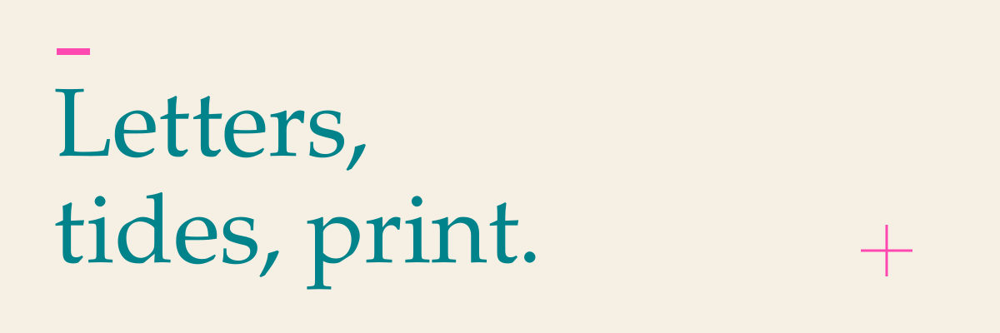
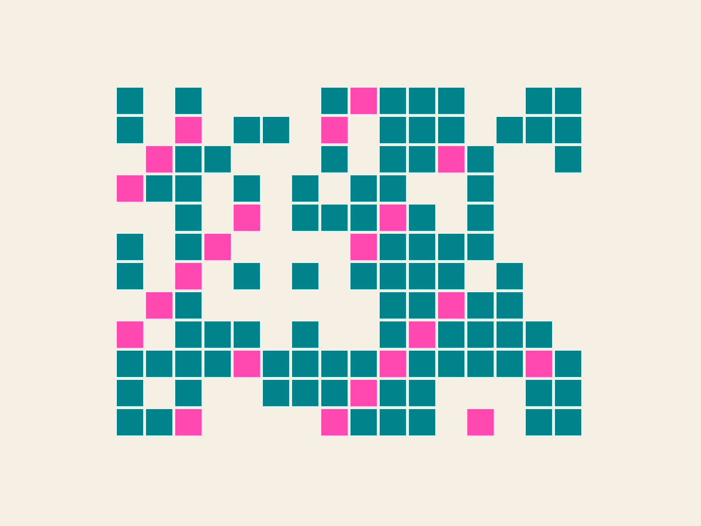
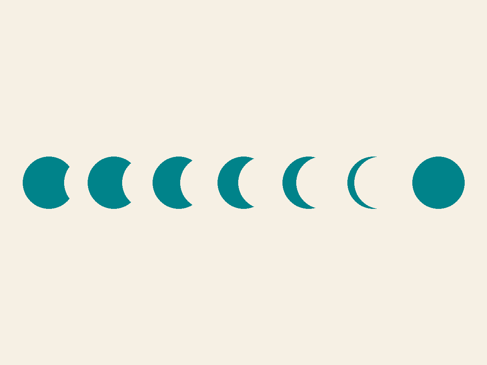
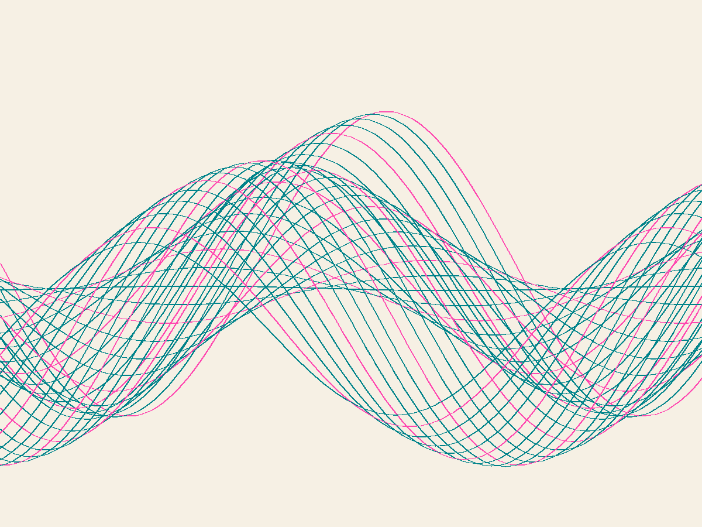

<h3>Noor Haddad</h3>

Type designer &amp; creative coder · Berlin / Amman

تصميم الخطوط والبرمجة الإبداعية · برلين / عمّان

<h3>01 &nbsp; kufic-grid</h3>

Arabic and Latin words become square Kufic lettering on a modular grid. A web tool and library, with editable letter-join rules and SVG exports for print and laser cutting.

أداة ويب ومكتبة لتوليد حروف كوفية مربّعة من كلمات عربية ولاتينية على شبكة وحدات، مع قواعد قابلة للتعديل لوصل الحروف وتصدير بصيغة SVG للطباعة والقص بالليزر.

<a href="https://github.com/noor-haddad-studio/kufic-grid">Explore kufic-grid / استكشف المشروع ↗</a>

 

<h3>02 &nbsp; Qamar / قمر</h3>

A variable Arabic/Latin display typeface, moving along a single axis from crescent-thin to full-moon black. Released under the SIL Open Font License.

خط عرض متغيّر للعربية واللاتينية، بمحور واحد يمتدّ من رقّة الهلال إلى ثقل البدر. متاح بموجب رخصة SIL المفتوحة للخطوط.

<a href="https://github.com/noor-haddad-studio/qamar-variable">Explore Qamar / استكشف قمر ↗</a>

 

<h3>Studies &amp; print / دراسات وطباعة</h3>

<b>Tide Sketches.</b> A daily practice: 120 p5.js sketches about water moving under the moon. Each sketch begins with a seed and a few rules.

<b>دراسات المدّ والجزر.</b> ممارسة يومية تضمّ ١٢٠ دراسة باستخدام p5.js عن حركة الماء تحت القمر. تبدأ كلّ دراسة ببذرة وقواعد قليلة.

<a href="https://github.com/noor-haddad-studio/tide-sketches">Browse Tide Sketches / تصفّح الدراسات ↗</a>

 

<b>riso-sep.</b> Separate an image into two to four risograph spot-colour layers, with halftone and trapping options.

أداة لفصل الصور إلى طبقتين إلى أربع طبقات من الألوان الموضعية لطباعة الريزوغراف، مع خيارات التنقيط النصفي وتداخل حواف الألوان.

<a href="https://github.com/noor-haddad-studio/riso-sep">Explore riso-sep / استكشف الأداة ↗</a>

 

<a href="https://noorhaddad.example.org">Visit the studio / زيارة الاستوديو ↗</a>

