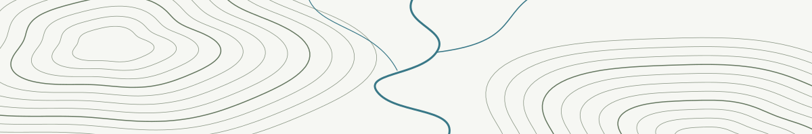

<picture>
  <source media="(prefers-color-scheme: dark)" srcset="./assets/watershed-dark.svg">
  <source media="(prefers-color-scheme: light)" srcset="./assets/watershed-light.svg">
  
</picture>

# Ilse · cartographer at heart

I'm a developer in Innsbruck. I like maps, Rust, and hiking — contour lines, river networks, and the quiet pleasure of reading a landscape.

### [contour-kit](https://github.com/ilse-maps/contour-kit)

Turn elevation rasters into contour lines for SVG and GeoJSON maps. Built in Rust, with line smoothing and index-contour labelling; also available as a Python package.

### [riverline](https://github.com/ilse-maps/riverline)

Follow a river downstream to the sea. A MapLibre app for exploring river networks in the browser, with stream order revealing the hierarchy of a basin.

---

Smaller tools for the same landscape:

- [tiles-at-home](https://github.com/ilse-maps/tiles-at-home) — serve vector tiles from a PMTiles file with a single binary, built for my maps on a Raspberry Pi.
- [gpx-trim](https://github.com/ilse-maps/gpx-trim) — split and simplify GPX tracks, and trim the stretches around private locations before sharing.
