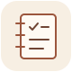

### Rafael · learning by building small things

I'm a second-year computer science student in Campinas, Brazil. Right now, I'm learning Rust.

Aprendendo um pouco de cada vez.

### A project I'm proud of

**[tiny-todo](https://github.com/rafa-souza-dev/tiny-todo)** — a small Python to-do list for the terminal, with tasks stored in SQLite.

This was the first project I tested properly. I learned about argparse subcommands, writing a SQL schema and migrations by hand, and testing with pytest and GitHub Actions.

### What I'm learning now

[My Rust exercises](https://github.com/rafa-souza-dev/rust-book-exercises) follow *The Rust Programming Language*. I'm on chapter 9, working through error handling. These are my notes and attempts as I learn.

---

You can reach me here on GitHub or at [rafa.souza.dev@example.com](mailto:rafa.souza.dev@example.com).
