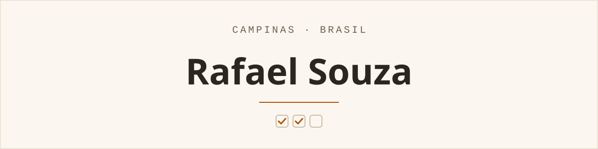
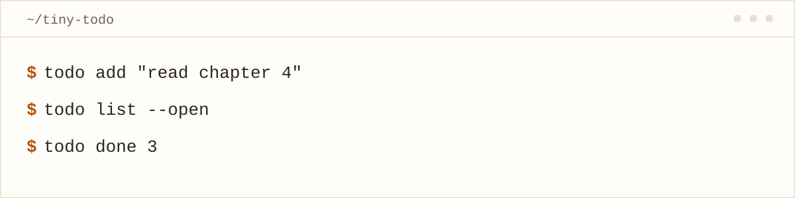

<picture>
  <source media="(prefers-color-scheme: dark)" srcset="./assets/hero-dark.svg">
  <source media="(prefers-color-scheme: light)" srcset="./assets/hero-light.svg">
  
</picture>

I'm a second-year computer science student in Campinas, Brazil. I learn by building one small, complete thing at a time — the kind that fits in a weekend, but ships with real tests and a README.

> Aprendo construindo coisas pequenas — uma de cada vez.

<h2 align="center">Things I've built</h2>

<a href="https://github.com/rafa-souza-dev/tiny-todo">
<picture>
  <source media="(prefers-color-scheme: dark)" srcset="./assets/tiny-todo-dark.svg">
  <source media="(prefers-color-scheme: light)" srcset="./assets/tiny-todo-light.svg">
  
</picture>
</a>

<h3><a href="https://github.com/rafa-souza-dev/tiny-todo">tiny-todo</a></h3>

A to-do list that lives in your terminal and keeps tasks in a local SQLite file — `argparse` subcommands and a schema I wrote by hand. The first thing I tested properly: 22 pytest tests, run in CI on every push.

<code>Python</code> · <code>SQLite</code> · <a href="https://github.com/rafa-souza-dev/tiny-todo"><kbd>Repository ↗</kbd></a>

### [rust-book-exercises](https://github.com/rafa-souza-dev/rust-book-exercises)

My solutions as I read <i>The Rust Programming Language</i>, up to chapter 9 (error handling). Notes and attempts, in public — not a reference.

<code>Rust</code>

<h2 align="center">Smaller things</h2>

<b>Smaller things</b> — course work, a tutorial rebuild, and my dotfiles

- **[ds-assignments](https://github.com/rafa-souza-dev/ds-assignments)** — data structures in C for a university course (MC202, 2025): linked lists, a chained hash table, a binary search tree.
- **[weather-now](https://github.com/rafa-souza-dev/weather-now)** — a weather app from a freeCodeCamp tutorial; I added the 5-day forecast and the °C/°F toggle on top.
- **[dotfiles](https://github.com/rafa-souza-dev/dotfiles)** — my terminal setup.

<h2 align="center">What I'm using</h2>

- **Python** — where most of my small projects live.
- **SQLite & the shell** — local data, and a terminal-first setup.
- **C** — university data-structures course work.
- **Rust** — what I'm learning right now, one chapter at a time.

<h2 align="center">Say hello</h2>

GitHub is the easiest way to reach me — open an issue or a discussion on anything I've built, or email me at <a href="mailto:rafa.souza.dev@example.com">rafa.souza.dev@example.com</a>.

