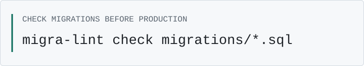

# I build tools that make Postgres safer to operate.

I'm Ingrid — staff-level engineer, previously SRE. I also speak at conferences about Postgres operations.

<picture>
  <source media="(prefers-color-scheme: dark)" srcset="./assets/migration-dark.svg">
  <source media="(prefers-color-scheme: light)" srcset="./assets/migration-light.svg">
  
</picture>

### Before production · after an incident

**[migra-lint](https://github.com/ingridh-demo/migra-lint)** — Flag migration statements that lock tables, rewrite them, or block writes; get safer alternatives. CLI, Go library, and GitHub Action.

**[pgwhen](https://github.com/ingridh-demo/pgwhen)** — Query a read-only Postgres endpoint at a past timestamp. Reconstruct state from WAL archives for incident forensics; works with pgBackRest and WAL-G.

### See what’s blocking

- [pg-lockviz](https://github.com/ingridh-demo/pg-lockviz) — Turn `pg_locks` snapshots into wait-for graphs: who blocks whom, on which relation.
- [tracehound](https://github.com/ingridh-demo/tracehound) — Break down query latency with eBPF, without application changes. Experimental; Linux ≥ 5.15.

### Conference talks

- **Locks you didn't know you took** — PGConf.EU 2025
- **Tracing the last millisecond** — P2D2 2026
- **Time travel for operators** — FOSDEM 2024, PostgreSQL devroom

[Slides, notes, and available recordings →](https://github.com/ingridh-demo/talks)

---

[Blog](https://ingrid.dev) · [Mastodon](https://hachyderm.io/@ingridh) · [LinkedIn](https://www.linkedin.com/in/ingrid-halvorsen-example)
